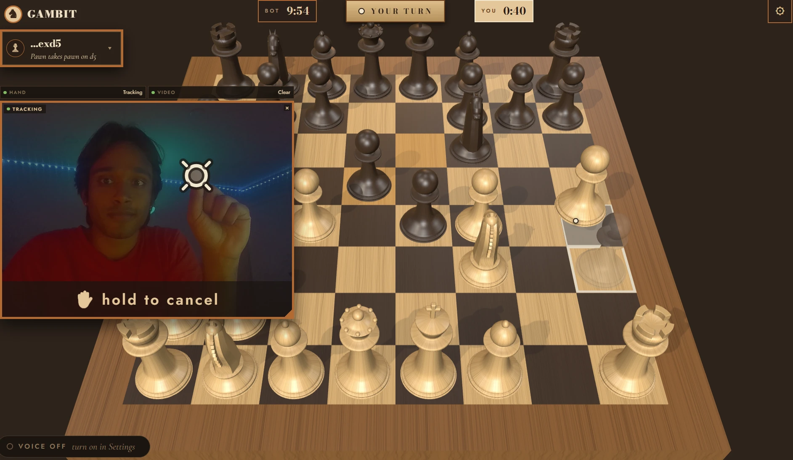
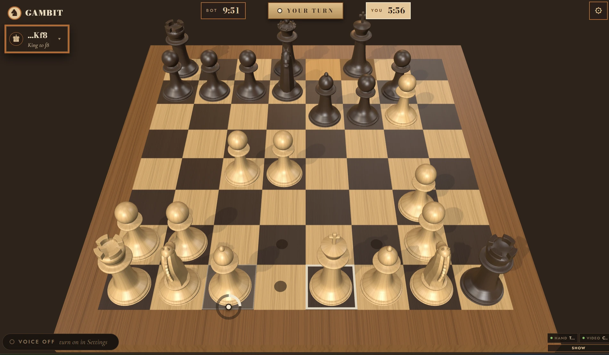
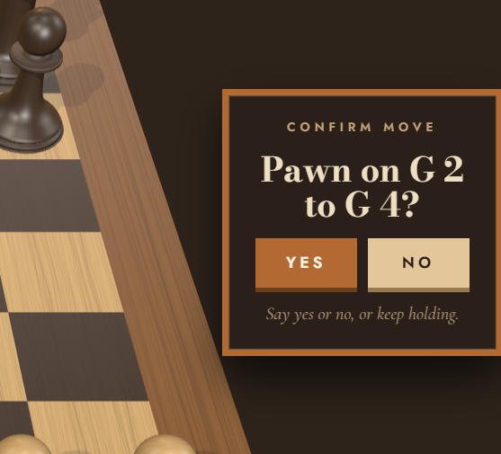
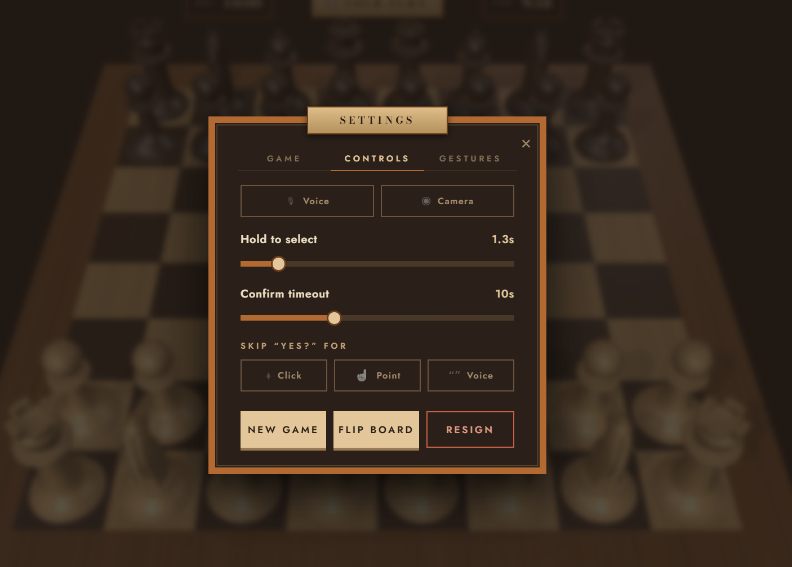
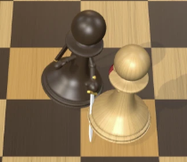
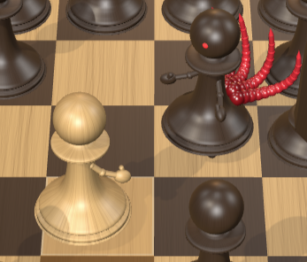

# Gambit: Hands-Free Chess

**Live:** https://gambit-amber.vercel.app

Chess you play without touching anything. Point at a piece to see its legal moves, say where it goes, and nothing moves until you say **yes**. Born out of hating the touch-move rule.

Phase 1: play Stockfish in 3D using your webcam and voice. See [SCOPE.md](SCOPE.md) for the roadmap.





| Confirm before anything moves | Settings |
|---|---|
|  |  |
| **Pieces fight on capture** | **And it gets messy** |
|  |  |

## Run it

```bash
npm install
npm run dev
```

Open http://localhost:5173 in **Chrome or Edge** (voice uses the browser's built-in speech recognition). Allow the microphone and camera when asked. No API keys.

## Controls

- **Point** with your index finger; **hold** on a piece (or **pinch**) to select it and show its moves, then hold or pinch on a target.
- **Say** moves: "knight f3", "e4", "move pawn to b4", "castle short", "this one", "there", "cancel".
- **Confirm** every move with "yes" or "no".
- Mouse clicks and typed commands (press `/`) work as fallbacks.

## Code map

| File | What it does |
|---|---|
| `src/scene.js` | three.js board, pieces, highlights, move animation, screen → square |
| `src/controller.js` | Move flow shared by every input: select, target, confirm, "which one?" |
| `src/parse.js` | Speech transcript → chess intent |
| `src/bot.js` | Stockfish worker and the strength model |
| `src/voice.js` | Speech recognition and text-to-speech |
| `src/hands.js` | MediaPipe hand tracking, cursor smoothing, pinch |
| `src/main.js` | Wires everything to the page |

```bash
npm test
```
